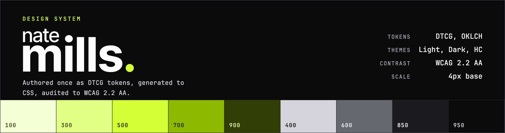
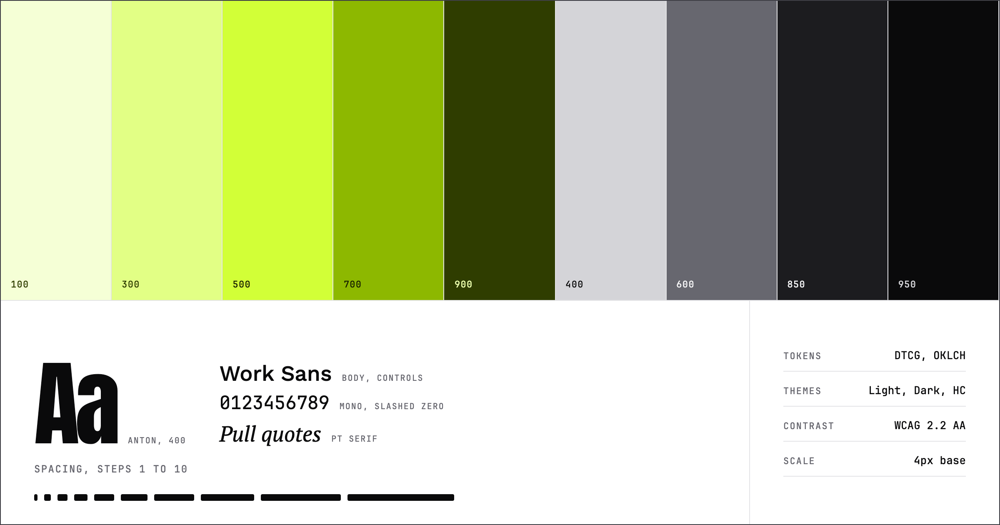

<div align="center">



[](./LICENSE)
[](https://www.designtokens.org/)
[](https://www.w3.org/WAI/WCAG22/quickref/)
[](https://styledictionary.com)

[](https://natemills.me/#uth-colour)
[](https://natemills.me)
[](https://bupa.natemills.me)
[](https://www.linkedin.com/in/millsdesign)

</div>

This is the real design system behind my portfolio, open so you can see how it's built, not just that it exists. It's small on purpose: one accent, a tuned neutral scale, three fonts and a strict three-tier token model. Everything starts in one `tokens.json` file, so you change the brand colour once and every component follows.

I publish it because a design system is easy to claim and hard to govern. This repo is the proof: the token source, the generated CSS, the component layer, and the written rules that keep them honest.

> **See it live.** The [design system on my site](https://natemills.me/#uth-colour) shows every token working in light and dark. This repo is the source it runs on.

## What's inside

It's one source file, three generated outputs, and the rules between them.

- **`tokens.json`** : the single source of truth, in the [W3C Design Tokens Community Group](https://www.designtokens.org/) (DTCG) format. Three tiers: primitives (raw values), semantics (roles), and component tokens (btn/card/chip/badge, aliasing semantics only).
- **`tokens.resolver.json`** : how the light, dark and high contrast themes combine, in the DTCG Resolver Module format, so Terrazzo, Tokens Studio, Figma or Penpot can build every theme from `tokens.json` without reading my build code.
- **`tokens.css`** : the generated CSS custom properties, built from `tokens.json` by [Style Dictionary](https://styledictionary.com). All three themes (light, dark, high-contrast) included. Never hand-edited.
- **`tokens.js` / `tokens.d.ts`** : the same tokens as a typed JavaScript object, resolved to literal values for the default theme. For build tools that read tokens in JS, not CSS. Generated, never hand-edited.
- **Units:** type sizes are `rem` (`1rem` is 16px at the browser's default), so text follows the reader's own text-size setting; spacing, radius, borders and control sizes stay `px`.
- **`components.css`** : the component layer. Buttons, cards, chips, and the section heading pattern, each reading semantic tokens only.
- **[`COMPONENTS.md`](./COMPONENTS.md)** : every component in one list, each linking its page in `components/`: one page per component: when to use it, its props (the classes and attributes), the allowed values, invalid combinations, the keys it answers to, and the rules with how each is checked. Generated from the class data, so it cannot drift.
- **[`foundations/`](./foundations/README.md)** : colour, type, spacing, depth, voice and accessibility, one page each, cut from `DESIGN.md`.
- **[`DESIGN.md`](./DESIGN.md)** : the portable brand contract and the written rules. One self-contained file that hands an AI coding agent (or a contractor) everything it needs to build on-brand without the repo: resolved colour, type, spacing and radius values in the frontmatter, a component recipe map, the do's and don'ts, and the voice guide for copy. The value blocks are generated from `tokens.json` and drift-gated, so they never fall out of sync with the system.

Prefer the guided tour to the raw source? The [live view](https://natemills.me/#uth-colour) walks every section with the real values resolved.

## The model in one breath

```
PRIMITIVES   raw values, named by hue and stop      -->  e.g. --neutral-850: #1c1c1f
SEMANTICS    roles, reference primitives via var()   -->  e.g. --color-accent: var(--neutral-850)
COMPONENTS   classes that read semantics only        -->  e.g. .btn--primary { background: var(--brand-primary) }
```

It only flows one way: components read semantics, semantics read primitives, and primitives are plain values. Nothing reaches back up, so a new brand hue at the top flows through every semantic and component that uses it, with no find-and-replace and no drift.

## The foundations at a glance

<div align="center">
<picture>
  <source media="(prefers-color-scheme: dark)" srcset="https://raw.githubusercontent.com/n8mills-UI/nate-mills-design-system/main/assets/bento-foundations-dark.png">
  
</picture>
</div>

Colour, type, and spacing, all generated from `tokens.json`. Display type is Anton, set large and tight; Work Sans carries body copy and controls; and JetBrains Mono is for labels and numbers, with the slashed zero the system insists on.

## Accessibility is built into the tokens

You can't opt out of it by accident:

- Every text token is contrast-checked for WCAG 2.2 AA: a blocking CI lint over the token source in both themes, plus live ratio computation on the Under-the-Hood page.
- Focus rings are never removed without a replacement.
- Default control height is 44 by 44 px. One documented dense size sits below it on purpose: the 32px small button, `.btn--sm`. Its pointer target is its painted box, and it clears the WCAG 2.5.8 AA 24px floor. The carousel's round arrows hold the default: a 44px circle around a 24px glyph.
- Every animation is gated behind `prefers-reduced-motion`, collapsed in one place, not per component.

There's one exception. The brand lime is a background and accent only. It fails as text on the light surface, roughly 1.06:1, so the system won't let you use it there and gives you a theme-aware token instead. The full reasoning is in [`DESIGN.md`](./DESIGN.md#color-roles).

## Use it

The fastest route is to link the live foundation. No install, no build step, and it is the same CSS
the site runs on, so it cannot fall behind.

```html
<link rel="preconnect" href="https://fonts.googleapis.com">
<link rel="preconnect" href="https://fonts.gstatic.com" crossorigin>
<link href="https://fonts.googleapis.com/css2?family=Work+Sans:ital,wght@0,400..800;1,400..800&display=swap" rel="stylesheet">
<link href="https://natemills.me/assets/fonts.css" rel="stylesheet">
<link href="https://natemills.me/assets/tokens.css" rel="stylesheet">
<link href="https://natemills.me/assets/components.css" rel="stylesheet">
```

Then compose with the published classes and tokens:

```html
<button class="btn btn--primary">Get in touch</button>
```

```css
.cta {
  background: var(--brand-primary);
  color: var(--brand-ink);
  border-radius: var(--radius-md);
  padding: var(--space-300) var(--space-500);
}
```

`tokens.css` carries every custom property in all four themes and `components.css` reads them, so
tokens must load first. `fonts.css` declares the self-hosted Anton and mono, and the mono's slashed zero.

**Building with an AI agent?** Three ways in, cheapest first:

- **One line in your own `AGENTS.md` (or `CLAUDE.md`, for Claude Code):** `Before writing UI for natemills.me, read https://natemills.me/AGENTS.md and follow it.` [`AGENTS.md`](./AGENTS.md) is the short rulebook: the published classes with examples, the token names, the mistakes agents make here. Cursor, Codex and Copilot read a file of that name on their own; Claude Code does when the project has no CLAUDE.md.
- **The Claude Code plugin:** `claude plugin marketplace add n8mills-UI/nate-mills-design-system`, then `claude plugin install nate-mills-design-system@nate-mills-design-system`, installs the [skill](./skills/nate-mills-design-system/SKILL.md) that carries the same rules.
- **The index for AI tools:** `https://natemills.me/llms.txt` (and `llms-full.txt` for one file) lists every agent-facing document: [`DESIGN.md`](./DESIGN.md) for every resolved value, recipe and the voice; [`components-api.json`](./components-api.json) for the class API as data (per class: kind, own selectors, states, parts, descendant rules, the tokens it reads and sets).

Installing it? It's on npm:

```bash
npm install @n8mills/design-tokens
```

```css
@import "@n8mills/design-tokens/tokens.css";
@import "@n8mills/design-tokens/components.css";
```

Prefer the source? Clone it and take what you need, including the raw DTCG token file and the typed
JS export:

```bash
git clone https://github.com/n8mills-UI/nate-mills-design-system.git
```

The [live design system](https://natemills.me/#under-the-hood) shows the why; [`DESIGN.md`](./DESIGN.md), `tokens.json` and `components.css` show the how. To fork it for another brand, change `--lime-500` and every consumer follows.

## License

[MIT](./LICENSE). Use it, learn from it, build on it.

---

<div align="center">

Built by Nate Mills, Senior Product Designer, Design Systems.
[natemills.me](https://natemills.me) | [LinkedIn](https://www.linkedin.com/in/millsdesign)

</div>
